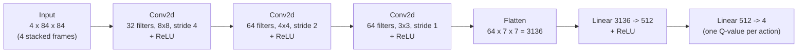

# Formative 3: Deep Q-Learning on Atari (Breakout)

## Project Introduction

This project implements a Deep Q-Network (DQN) agent from scratch using PyTorch and Gymnasium. The agent learns to play Atari Breakout by interacting with the environment, using only raw screen observations and a reward signal. No ready-made DQN library is used.

## Group Members

- [Name 1]: Task 1, environment setup and README environment section
- [Name 2]: Task 2, `train.py`
- [Name 3]: Task 3, hyperparameter experiments
- [Name 4]: Task 4, `play.py`

See `Task allocation sheet.pdf` for full responsibilities.

## Selected Atari Environment

**Environment ID:** `ALE/Breakout-v5`

### Game objective

The player controls a paddle at the bottom of the screen and bounces a ball to break the bricks at the top. The goal is to break as many bricks as possible while keeping the ball in play. The episode ends when all lives are lost.

### Action space

The agent has 4 discrete actions:

| Action | Meaning |
|--------|---------|
| 0 | NOOP (do nothing) |
| 1 | FIRE (launch the ball) |
| 2 | RIGHT (move paddle right) |
| 3 | LEFT (move paddle left) |

### Rewards

Rewards are given when the ball breaks a brick. The points depend on the colour of the brick's row, as documented in the Atari game manual. The agent receives no reward for losing a life.

### Why we chose Breakout

- **Small action space:** With 4 actions, the Q-network's output layer is small and the Q-values are easy to explain.
- **Frequent rewards:** Bricks are hit often, so the agent gets feedback early in training.
- **Clear objective:** The goal is easy to describe and easy to see on screen.
- **Visible improvement:** Random play scores a few points, and a trained agent clears more bricks, so progress shows clearly on a reward curve.
- **Practical on CPU:** Frames are reduced to 84×84 grayscale and stacked (4 frames), which keeps the network small enough for CPU training.
- **Known start requirement:** The ball does not launch until FIRE is pressed, and FIRE is needed again after each lost life. Handling this in code shows understanding of the environment.

## Environment Setup

The project uses [uv](https://docs.astral.sh/uv/) for dependency management.

```bash
git clone https://github.com/enockmugisha1/formative3-dqn-atari.git
cd formative3-dqn-atari
uv sync
uv run python check_env.py
```

### Preprocessing pipeline

```python
env = gym.make("ALE/Breakout-v5", frameskip=1, repeat_action_probability=0.0)
env = AtariPreprocessing(env, frame_skip=4, screen_size=84, grayscale_obs=True)
env = FrameStackObservation(env, stack_size=4)
```

| Step | Purpose |
|------|---------|
| `frameskip=1`, `repeat_action_probability=0.0` | Turns off the built-in frame skipping and sticky actions, so training is repeatable |
| `AtariPreprocessing` (frame skip 4, 84×84, grayscale) | Repeats each action for 4 frames and reduces the observation size |
| `FrameStackObservation` (4 frames) | Stacks the last 4 frames so the network can see motion |

The resulting observation shape is `(4, 84, 84)`.

### Environment verification

Output of `check_env.py`:

Observation shape: (4, 84, 84)
Actions: Discrete(4)
Random agent reward over 500 steps: 2.0


## DQN Architecture

### Q-network (CNN)

The Q-network takes the stack of 4 preprocessed frames and outputs one Q-value per action. We implemented it ourselves with `torch.nn` (no pretrained models), following the classic DQN architecture:



| Layer | Output shape | Purpose |
|-------|--------------|---------|
| Input (pixels scaled to 0–1) | 4 × 84 × 84 | Last 4 frames, so the network can see motion |
| Conv 32 filters, 8×8, stride 4 + ReLU | 32 × 20 × 20 | Detect large shapes (paddle, walls) |
| Conv 64 filters, 4×4, stride 2 + ReLU | 64 × 9 × 9 | Detect smaller patterns (ball, bricks) |
| Conv 64 filters, 3×3, stride 1 + ReLU | 64 × 7 × 7 | Combine features |
| Flatten + Linear 3136 → 512 + ReLU | 512 | Mix all spatial features together |
| Linear 512 → 4 | 4 | Q-value for NOOP, FIRE, RIGHT, LEFT |

### Online and target networks

We keep **two copies** of this network:

- The **online network** picks actions and is trained on every update.
- The **target network** is a frozen copy used only to compute the Bellman targets. Every 1,000 steps we copy the online weights into it. Without this, the target would move on every update and training becomes unstable.

## Training Process

Training runs in `train.py` (`uv run python train.py`). Hyperparameters are constants at the top of the file, so each experiment in Task 3 only needs those values changed.

1. **Replay buffer** — every step, the transition `(state, action, reward, next_state, done)` is stored in a buffer holding the last 20,000 experiences. Training samples random batches from it, which breaks the correlation between consecutive frames.
2. **ε-greedy action selection** — with probability ε the agent takes a random action (exploration), otherwise it takes the action with the highest Q-value from the online network (exploitation). ε decays **linearly** from 1.0 to 0.05 over the first 100,000 steps, so the agent explores a lot early and exploits what it learned later.
3. **Bellman target and loss** — for each sampled transition, the online network predicts `Q(state, action)`, and the target is computed with the Bellman equation using the target network: `target = reward + γ · max_a Q_target(next_state, a)` (the future term is dropped when the episode ended). The loss between prediction and target is the Huber loss (`SmoothL1Loss`), and the online network is updated by backpropagation with the Adam optimizer. Learning starts after 5,000 warm-up steps, with one update every 4 environment steps.
4. **Target network update** — every 1,000 steps the online weights are copied into the target network.
5. **Logging and saving** — every episode's length, total steps, reward, and ε are printed and written to `plots/training_log.csv`; a reward curve is saved to `plots/training_rewards.png`; the model is saved to `dqn_model.pth` every 10,000 steps and at the end.

## Hyperparameter Experiments

*To be completed by the team member responsible for Task 3.*

Each member's results are in `[Name]Hyperparameter_experiment_results.md`. Models are stored in `models/[name]/`, and training plots are in `plots/`.

## Gameplay Demonstration

*To be completed by the team member responsible for Task 4.*

- Video of the best trained agent playing Breakout (`play.py`)

## Repository Contents

| File | Description |
|------|-------------|
| `check_env.py` | Verifies the environment setup |
| `train.py` | DQN training script (Task 2) |
| `play.py` | Loads the trained model and plays the game (Task 4) |
| `dqn_model.pth` | Final trained model |
| `models/[name]/` | Each member's saved experiment models |
| `plots/` | Training plots |
| `Task allocation sheet.pdf` | Group task allocation |
| `Presentation booking.pdf` | Presentation slot booking |
